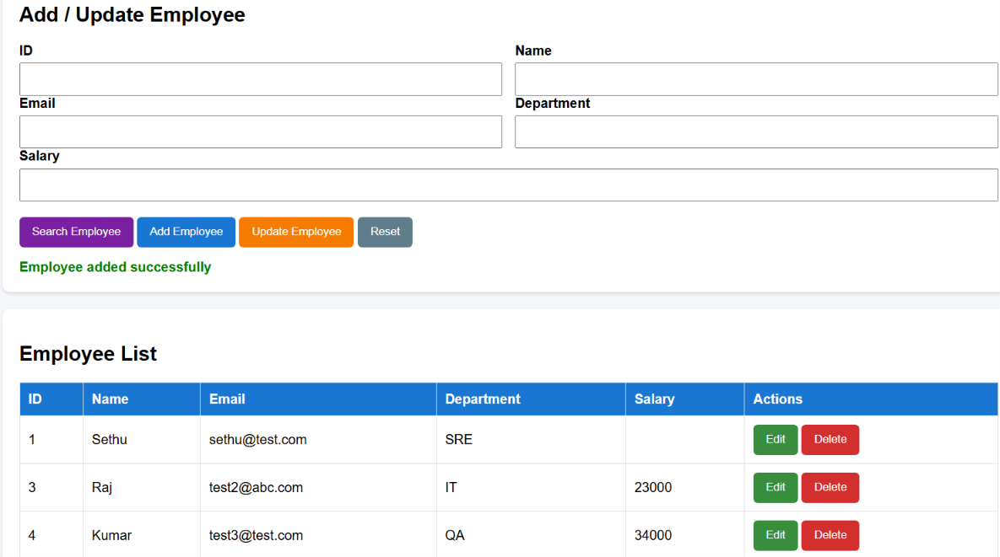
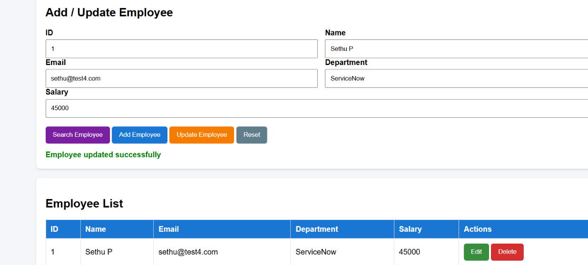
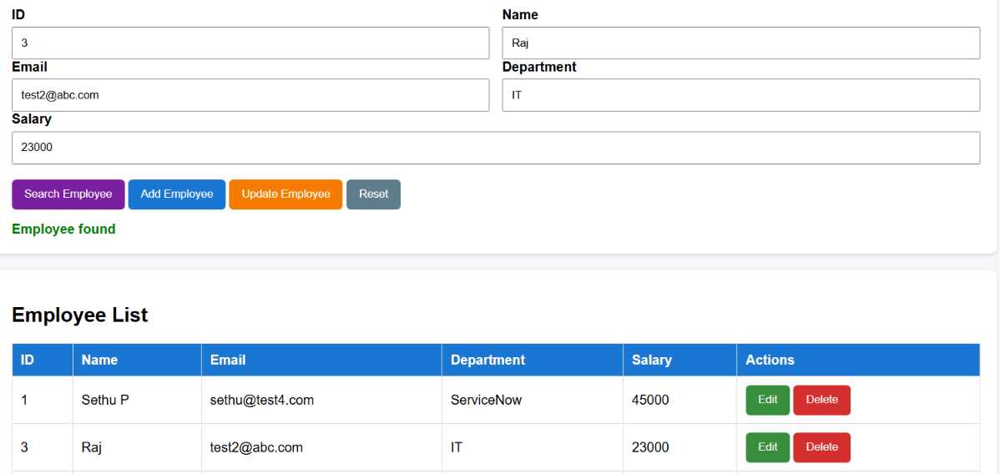
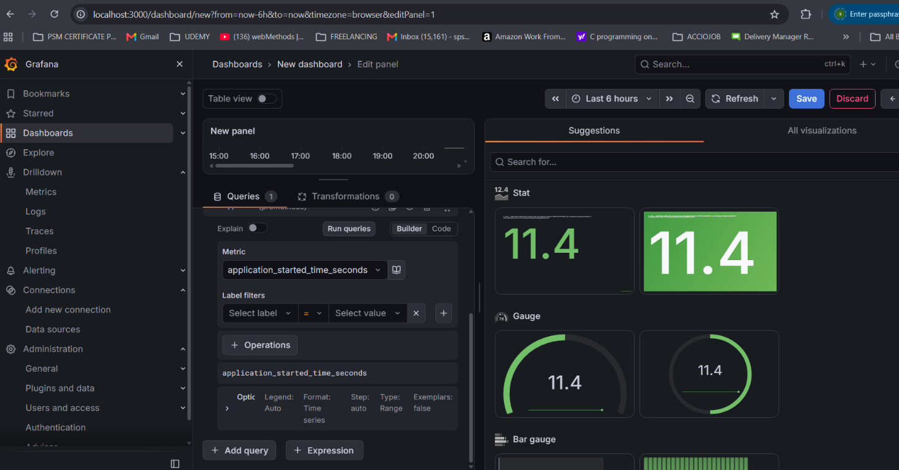
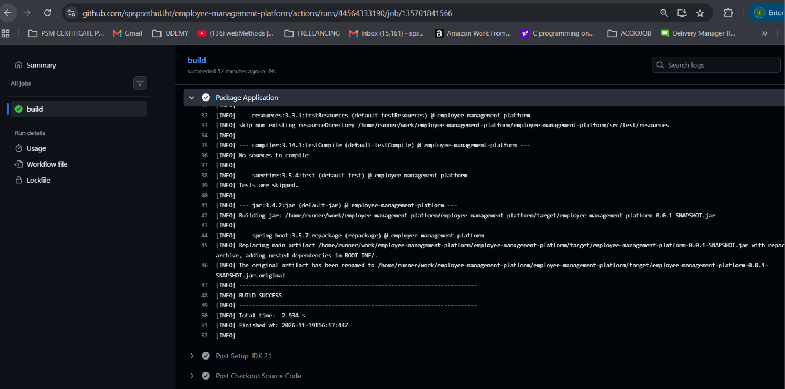

# Employee Management Platform

A full-stack cloud-native Employee Management Platform built using Spring Boot, AWS RDS MySQL, Docker, AWS EC2, Prometheus, Grafana, and GitHub Actions.

---

## Project Overview

This project demonstrates end-to-end application development, containerization, cloud deployment, observability, monitoring, and Continuous Integration (CI).

The application enables employee management through a web-based user interface and REST APIs, and is deployed on AWS using Docker containers and a persistent MySQL database.

---

## Architecture

```text
Browser
    ↓
HTML / CSS / JavaScript Frontend
    ↓
Spring Boot REST APIs
    ↓
Spring Data JPA
    ↓
AWS RDS MySQL

Observability:
Spring Boot Actuator
    ↓
Prometheus
    ↓
Grafana

CI Pipeline:
GitHub
    ↓
GitHub Actions
```

---

## Technology Stack

### Frontend

- HTML5
- CSS3
- JavaScript

### Backend

- Java 21
- Spring Boot
- Spring Data JPA
- Hibernate

### Database

- AWS RDS MySQL

### Build Tool

- Maven

### Containerization

- Docker
- Docker Hub

### Cloud

- AWS EC2
- AWS RDS

### Monitoring & Observability

- Spring Boot Actuator
- Micrometer
- Prometheus
- Grafana

### DevOps

- Git
- GitHub
- GitHub Actions

### Kubernetes

- Deployment YAML
- ConfigMap
- Secret
- Liveness Probe
- Readiness Probe

---

## Features

### Employee Management

- Create Employee
- Search Employee by ID
- Update Employee
- Delete Employee
- List Employees

### Cloud Features

- Dockerized Application
- AWS EC2 Deployment
- AWS RDS Integration
- Persistent Data Storage

### Observability

- Application Health Monitoring
- JVM Metrics
- Database Connection Pool Metrics
- Startup Duration Metrics
- Prometheus Integration
- Grafana Dashboards

### CI/CD

- Automated Build Verification
- JDK Setup
- Maven Build
- JAR Packaging
- GitHub Actions Workflow

---

## REST APIs

### Get All Employees

```http
GET /employees
```

### Get Employee By ID

```http
GET /employees/{id}
```

### Create Employee

```http
POST /employees
```

Example Request

```json
{
  "name": "Sethu",
  "email": "sethu@test.com",
  "department": "SRE",
  "salary": 100000
}
```

### Update Employee

```http
PUT /employees/{id}
```

### Delete Employee

```http
DELETE /employees/{id}
```

---

## Monitoring Endpoints

### Health Endpoint

```http
GET /actuator/health
```

### Prometheus Metrics

```http
GET /actuator/prometheus
```

---

## Application Screenshots

### Employee Management Dashboard



### Employee Update



### Employee Search



---

## Prometheus Monitoring

The application exposes metrics through Spring Boot Actuator and Micrometer.

Examples:

- Database Connection Pool Usage
- JVM Metrics
- Startup Duration
- Thread Metrics
- Garbage Collection Metrics

### Prometheus Metrics


---

## Grafana Dashboards

Implemented Grafana dashboards for:

- Database Connections
- JVM Memory Monitoring
- JVM Garbage Collection
- Application Startup Time
- Thread Utilization

### Grafana Monitoring Dashboard



---

## GitHub Actions CI

Implemented GitHub Actions Continuous Integration workflow to automatically build and validate the project on every push.

### Build Pipeline

- Checkout Source Code
- Setup JDK 21
- Maven Build
- Package Spring Boot Application

### GitHub Actions Build Success



---

## AWS Deployment

### EC2

- Ubuntu EC2 Instance
- Docker Runtime
- Spring Boot Container

### RDS

- AWS RDS MySQL
- Persistent Data Storage
- Survives Docker Container Restart

---

## Persistence Validation

Validated application persistence with the following test:

1. Added Employee
2. Restarted Docker Container
3. Verified Data Still Exists

This confirms successful integration with AWS RDS MySQL.

---

## Project Learnings

- Full-Stack Web Development
- REST API Design
- Spring Boot Development
- Docker Containerization
- AWS Cloud Deployment
- Kubernetes Fundamentals
- Prometheus Monitoring
- Grafana Dashboards
- GitHub Actions CI
- Cloud-Based Persistence
- Observability Engineering

---

## Future Enhancements

- GitHub Actions Docker Image Build
- Automated EC2 Deployment
- Prometheus Alerting
- Grafana Alert Rules
- Spring Security Integration
- Role-Based Access Control
- Kubernetes Monitoring

---

## Author

**Sethu P**

Senior IT Professional | SRE Trainer | Cloud & Observability Enthusiast

GitHub Repository:

https://github.com/spspsethuUht/employee-management-platform
